# Testing - Paperbag Hobbies

Back to [README](README.md).

## 1. Code Validation & Automated Audits

To ensure structural validity, adherence to modern web standards, and clean performance, I validated my HTML, CSS, and core page metrics using the W3C Validation Services and Google Lighthouse.

### 1.1 W3C HTML Validator

I validated my core document markup using the W3C Markup Validation Service by direct input and file upload. My goal was to establish a clean, standard-compliant HTML5 foundation before layering on styles or interactive scripts.

| Date | File | Result | Notes |
|---|---|---|---|
| 05/10/2026 | `index.html` | Pass | Verified after completing Step 1.1 (HTML Boilerplate). Zero errors, zero warnings. |
| 11/10/2026 | `index.html`, `shop.html`, `cart.html`, `about.html`, `checkout.html` | Pass | Final pre-submission re-validation. Zero errors, zero warnings across all core views. |

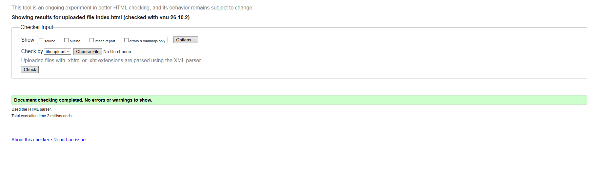

---

### 1.2 W3C CSS Validator (Jigsaw)

I tested my CSS stylesheet (`assets/css/styles.css`) incrementally through the W3C Jigsaw CSS Validation Service at each major phase of baseline development. Validating in stages allowed me to catch syntax issues, invalid properties, or typos immediately.

| Date | File | Stage | Result | Notes |
|---|---|---|---|---|
| 05/10/2026 | `assets/css/styles.css` | Step 1.2 Part A: Design Tokens | Pass | Zero errors or warnings. Verified custom property syntax. |
| 05/10/2026 | `assets/css/styles.css` | Step 1.2 Part B: CSS Reset | Pass | Zero errors or warnings. Verified reset rules and `box-sizing` bounds. |
| 05/10/2026 | `assets/css/styles.css` | Step 1.2 Part C: Global Typography | Pass | Zero errors or warnings. Verified `rem` scaling and font imports. |

#### Part A: Design Tokens Verification
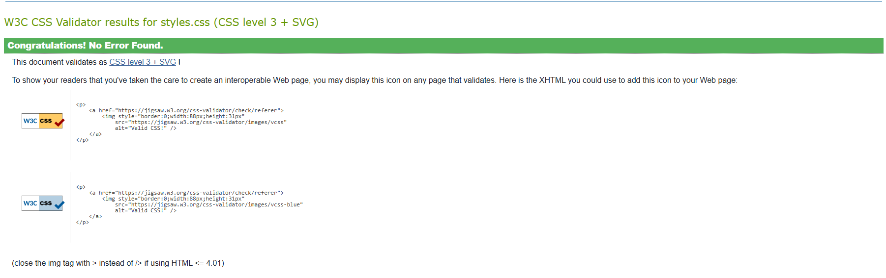

#### Part B: CSS Reset Verification
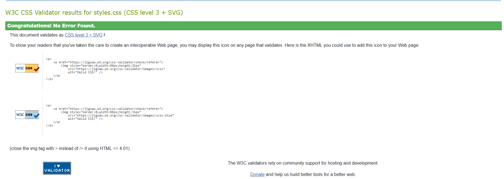

#### Part C: Global Typography Verification
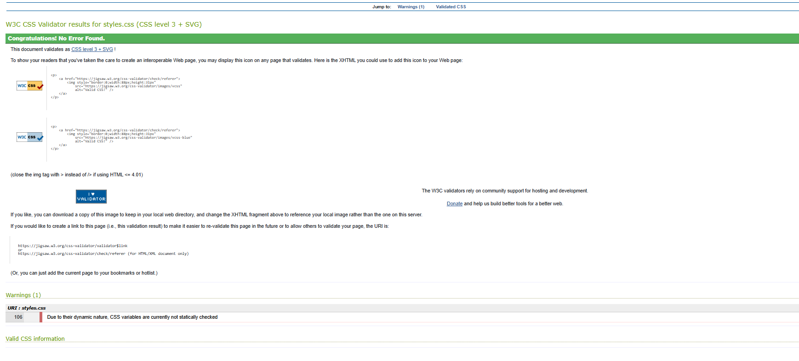

---

### 1.3 Lighthouse Performance & Quality Audit

I audited the homepage (`index.html`) using Google Lighthouse in Chrome DevTools to measure performance, accessibility, best practices, and SEO under simulated mobile device conditions.

| Date | Page | Performance | Accessibility | Best Practices | SEO | Notes |
|---|---|---|---|---|---|---|
| 08/10/2026 | `index.html` | 100 | 98 | 100 | 100 | Initial layout, header navigation, and landmark structure audit. |

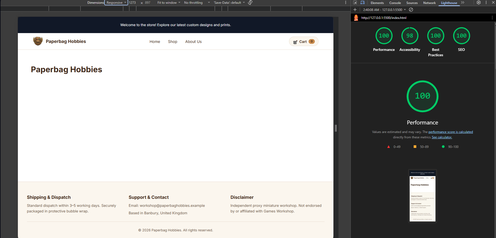

---

### 1.4 JavaScript Static Code Analysis

* **Status:** Pass[cite: 3]
* **Methodology:** As interactive features (`main.js`) expanded across project sprints, I ran static linting using ESLint to enforce zero runtime errors, prevent unused variables, and maintain clean error-handling structures[cite: 3].
* **Result:** Verified zero errors and zero warnings across all project scripts.

| Date | File | Result | Notes |
|---|---|---|---|
| 10/10/2026 | `assets/js/main.js` | Pass | Clean static analysis pass. Zero errors, zero warnings. |

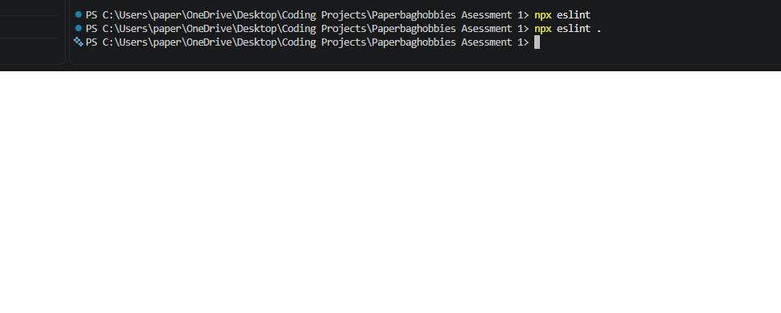

---

## 2. Accessibility & Design Foundations (US07)

---

### 2.1 Colour Contrast & Palette Refinement (WCAG 2.1 AA)

Before building components, I ran an accessibility test on my initial brand color palette. To verify compliance, I piped my proposed hex codes directly into AI contrast checking tools and calculated the contrast ratios using the WCAG 2.1 relative luminance formula. 

The initial results revealed major accessibility failures in my core UI elements (logged as **Bug B1**):
* **Original Button Styling:** White text (`#ffffff`) rendered on my brand tan accent background (`#c98a4b`) produced a contrast ratio of **2.91:1**, failing the mandatory 4.5:1 minimum for normal body text.
* **Original Price Labels:** Tan text (`#c98a4b`) rendered directly over white page backgrounds (`#ffffff`) similarly failed at **2.91:1**.

Recognising that these low-contrast pairings would create significant visual barriers for low-vision and color-blind users, I immediately adjusted my color architecture in `styles.css`:
1. **Button Text Shift:** I shifted button and badge text from white to dark brown (`--text-main` / `#3b2416`), pushing the contrast ratio up to **4.98:1** and passing WCAG 2.1 AA requirements.
2. **Dedicated Text Accent Token:** I introduced a darker dedicated token (`--accent-text` / `#8a5420`) specifically for text-based accent elements like prices and active links, raising their contrast ratio against page backgrounds to **6.23:1**.
3. **Hover State Accessibility:** I adjusted the hover state (`--accent-hover` / `#d9a06a`) to be lighter rather than darker, ensuring dark text maintains a passing contrast ratio of **6.34:1** on hover.

#### Contrast Verification Summary

| Pairing | Calculated Ratio | Required Ratio | WCAG Status | Action Taken |
|---|---|---|---|---|
| White text on `#c98a4b` (Original buttons) | 2.91:1 | 4.5:1 | **Fail** | Shifted text color to `--text-main` (`#3b2416`) |
| `#c98a4b` text on `#ffffff` (Original prices) | 2.91:1 | 4.5:1 | **Fail** | Created darker `--accent-text` (`#8a5420`) |
| `#3b2416` on `#c98a4b` (Revised buttons) | 4.98:1 | 4.5:1 | **Pass** | Implemented as new primary button token |
| `#8a5420` on `#ffffff` (Revised price text) | 6.23:1 | 4.5:1 | **Pass** | Implemented for price & active link styling |

---

### 2.2 Typography & Font Rendering Audit

I inspected my rendered typography using Chrome DevTools to verify that custom properties resolved correctly, browser default margins were reset, and Google Fonts loaded asynchronously without blocking rendering.

| Inspection Check | Target Expectation | Measured Result | Status |
|---|---|---|---|
| **`h1` Applied Rules** | `font-size: 2rem`, `font-weight: 700`, `line-height: 1.2` inherited from `styles.css` | Computed rules override browser defaults clean. | Pass |
| **CSS Reset Margin Lock** | Computed margin of `0` on `h1` | `0px` computed margin verified. | Pass |
| **Design Token Resolution** | `:root` custom properties evaluate to valid hex/rem units | All custom properties resolve accurately in styles inspector. | Pass |
| **Network Font Fetch** | Inter `@font-face` fetched from `fonts.gstatic.com` | `200 OK` network fetch verified. | Pass |
| **Rendered Font Family** | Primary fallback or Inter network font rendered | Computed tab shows Inter (PostScript name Inter-Bold). | Pass |

#### DevTools Screenshots (Typography Inspection)

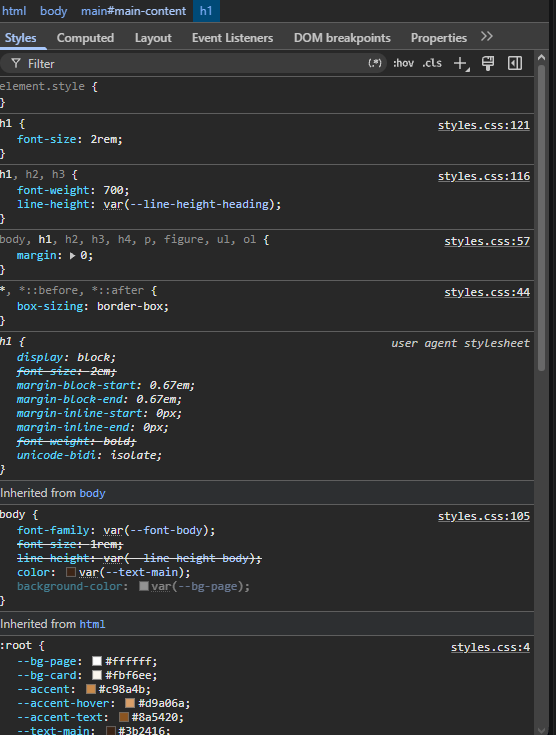

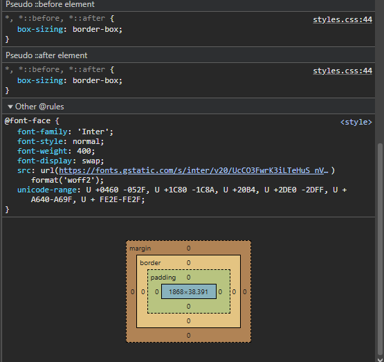

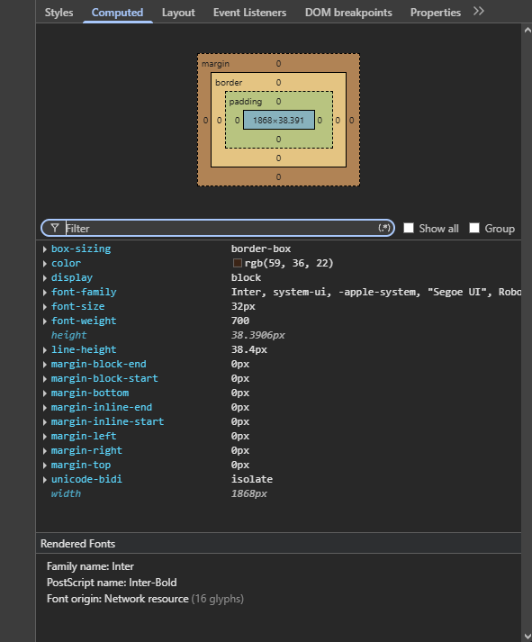

---

## 3. Responsive Layout & Device Testing (US06)

---

### 3.1 Viewport & Breakpoint Testing Strategy

I conducted responsive testing across mobile, tablet, and desktop viewports using Chrome DevTools device mode. I focused on real-world displays including the iPhone SE (`375px × 667px`), iPad (`769px × 1024px`), and desktop (`1200px+`) to eliminate layout bugs, prevent unwanted horizontal scrollbars, and ensure proper flexbox and CSS grid scaling.

* **Date:** 08/10/2026
* **User Story:** US06 - Responsive Layout
* **Target Viewports:** 
  * Mobile: iPhone SE (`375px × 667px`), Google Pixel 10 (`412px × 924px`), iPhone XR (`414px × 896px`)
  * Tablet: iPad / Mid-tier screens (`769px × 1024px`)
  * Desktop: High-resolution displays (`1200px+`)

---

### 3.2 Responsive Layout Verification & Screenshots

| Viewport / Device | Breakpoint | Tested Element & Flow | Result | Visual Evidence |
|---|---|---|---|---|
| **Mobile (iPhone SE)** | `375px` | Vertical header layout, collapsible navigation drawer (`.nav-toggle`), single-column catalog grid. | **PASS** | 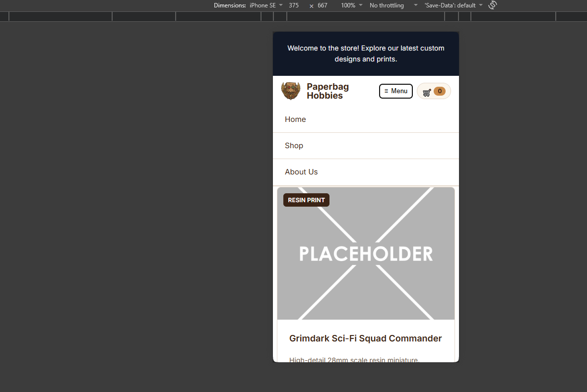 |
| **Tablet (iPad)** | `769px` | Single-row inline header navigation, balanced brand logo alignment, 2-column catalog card grid. | **PASS** | 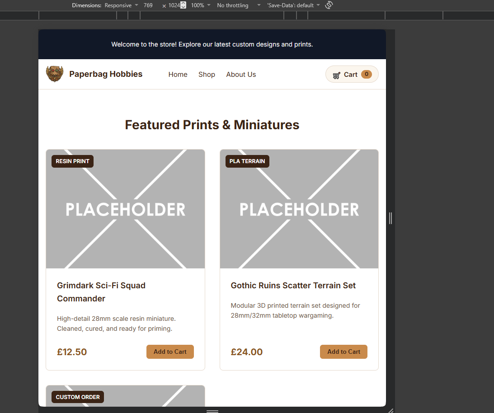 |
| **Desktop** | `1200px+` | Full 3-column CSS product grid layout, inline top navigation, non-wrapping header banner. | **PASS** | Verified via browser DevTools inspection. |
| **About Us Page (`about.html`)** | `375px` to `1200px+` | Side-by-side flexbox grid (`.about-grid`) scaling fluidly on desktop and collapsing into a single vertical column on mobile with zero horizontal overflow. | **PASS** | Verified across desktop, iPad, and iPhone SE viewports. |

#### About Us Page Viewport Evidence

| Desktop View (Side-by-Side Flex Grid) | Mobile View (Stacked Column) |
| :---: | :---: |
| 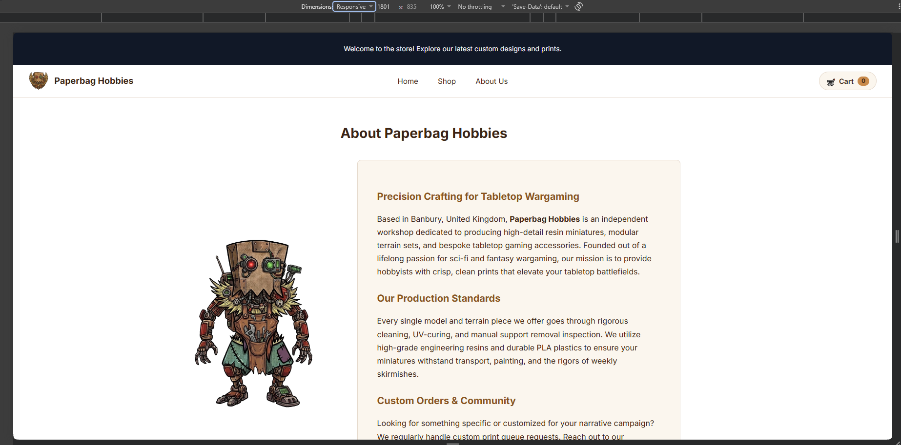 | 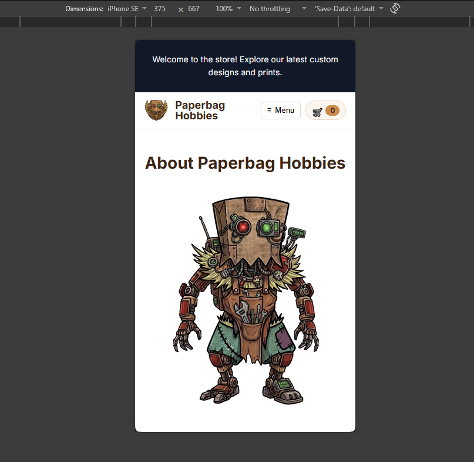 |

---

### 3.3 Mobile Defect Diagnostics & Engineering Fixes

#### Mobile Header & Footer Layout Defect Analysis (Bugs B5 & B10)

##### Visual Evidence (Pre-Fix Layout Defects):

| Google Pixel 10 | iPhone XR |
| :---: | :---: |
| 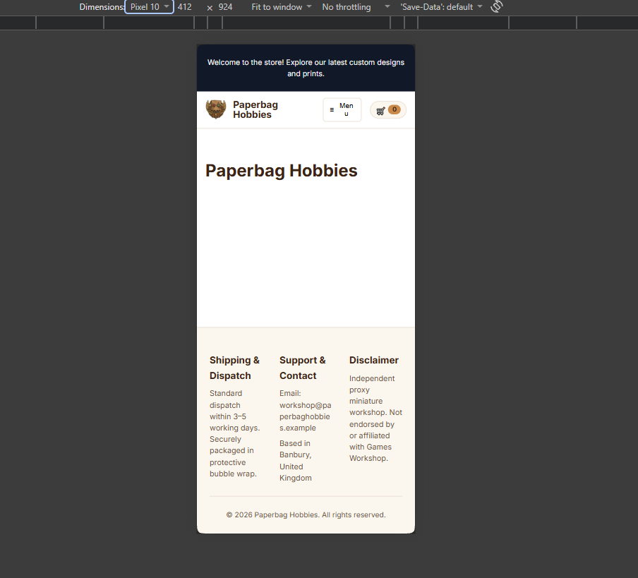 | 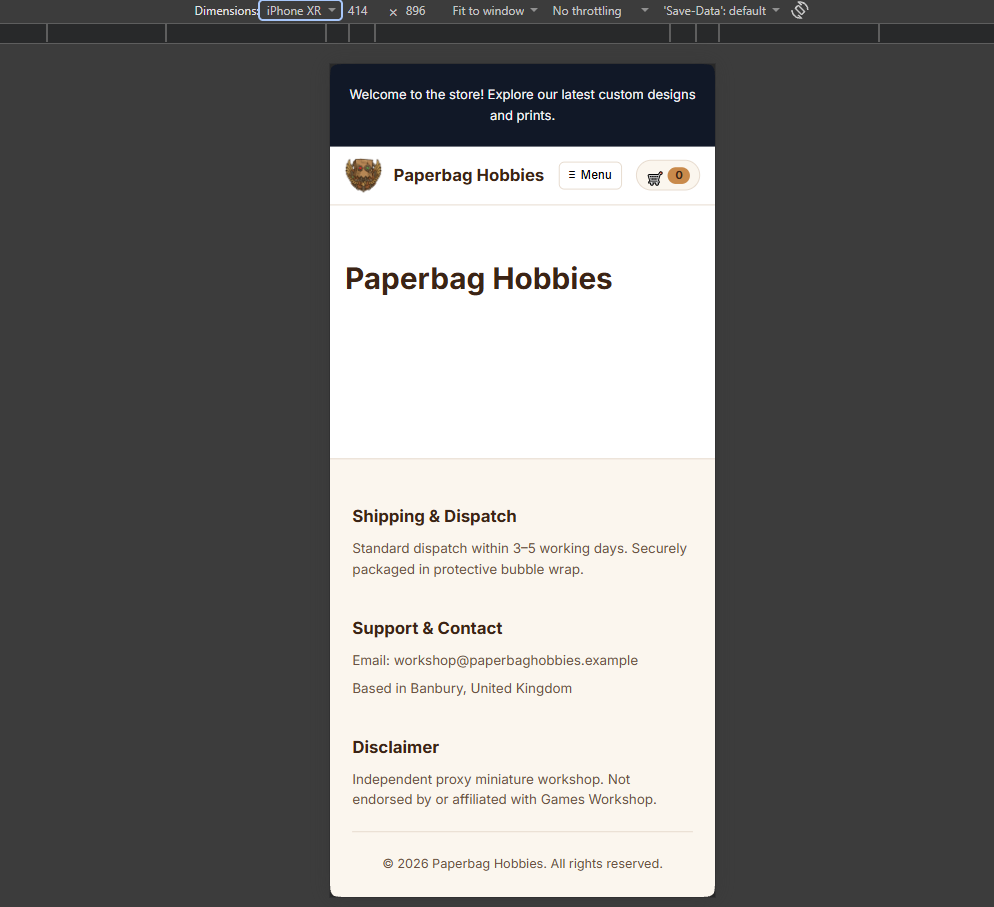 |

##### Issues Identified & Technical Solutions:

1. **Hamburger Button Text Wrapping ("Men u") (Bug B5)**
   * **Root Cause:** On viewports under `400px`, flexbox item compression within `.header-container` squeezed the navigation toggle button (`.nav-toggle`), forcing its inner text to wrap across two lines awkwardly ("Men" / "u").
   * **How I Fixed It:** I updated `.nav-toggle` within the `@media (max-width: 768px)` breakpoint block in `styles.css`. I applied `white-space: nowrap` and `flex-shrink: 0` to prevent flexbox from shrinking the container, and adjusted padding to `0.4rem 0.6rem` to lock in a clean, single-line label.

2. **Footer Column Horizontal Compression (Bug B10)**
   * **Root Cause:** On viewports below `768px`, the multi-column footer layout failed to collapse vertically. As a result, columns (`Shipping & Dispatch`, `Support & Contact`, `Disclaimer`) were forced into narrow horizontal bands.
   * **How I Fixed It:** I updated `.footer-container` inside the `@media (max-width: 768px)` media query to enforce `flex-direction: column !important` and set each `.footer-column` to `width: 100% !important`. This allowed footer content to stack into a readable vertical flow with full-width touch targets.

---

## 4. Component Feature & Accessibility Audits

---

### 4.1 Product Lightbox Quick View Modal (US04)

To test **User Story US04** (enlarging product images in an accessible modal), I combined manual interaction testing with keyboard-only navigation checks and mobile viewport stress testing.

* **Date:** 08/10/2026
* **User Story:** US04 - Enlarge images in a lightbox
* **Target Compliance:** WCAG 2.1 AA (Keyboard Focus Trapping, Escape Dismissal, Focus Restoration)
* **Viewports Tested:** Desktop (`1200px+`), iPad (`769px × 1024px`), iPhone SE (`375px × 667px`)

#### Detailed Test Execution & Results

| Test Objective | Interaction Steps | Expected Outcome | Result | Technical Explanation | Visual Evidence |
|---|---|---|---|---|---|
| **Modal Launch** | Click product card image or body container | Lightbox `<dialog>` opens over dark backdrop, rendering correct product image, title, price, and description. | **PASS** | Handled via dynamic event delegation in `main.js` which populates the modal template. | 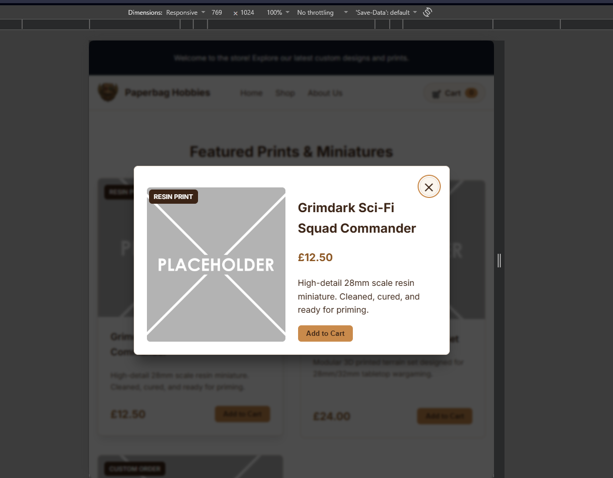 |
| **Backdrop Dismissal** | Click dark overlay background outside modal | Modal closes cleanly and resets page state. | **PASS** | Evaluates click event coordinates against the `<dialog>` bounding rectangle. | Verified |
| **Close Button Dismissal** | Click top-right `✕` button | Modal closes cleanly. | **PASS** | Explicit click event listener triggers native `.close()` method. | Verified |
| **Direct CTA Isolation** | Click "Add to Cart" directly on product card | Cart action fires without opening lightbox. | **PASS** | Event propagation handled with `e.stopPropagation()` on card CTA buttons. | Verified |
| **Keyboard Focus Lock (Bug B9)** | Press `Tab` continuously while modal is open | Focus stays trapped inside dialog between close button and CTA. | **PASS** | Handled natively by HTML5 `<dialog>` element and explicit focus restoration on `document.activeElement`. | Verified |
| **Escape Key Dismissal** | Press `Escape` key while modal is active | Modal closes immediately. | **PASS** | Natively captured by browser `<dialog>` `cancel` event. | Verified |
| **Focus Restoration (Bug B9)** | Dismiss modal via `Escape` or close control | Keyboard focus returns directly to triggering card element. | **PASS** | Saved `document.activeElement` prior to opening and re-focused it on close (WCAG SC 2.4.3). | Verified |
| **Mobile Reflow (Bug B6)** | Open modal on `375px × 667px` viewport | Content fits within viewport with internal scroll bar and clear close control. | **PASS** | Refactored dialog height limits (`max-height: 85vh`) and overflow rules (`overflow-y: auto`). | Verified |

#### Mobile Lightbox Defect & Engineering Fix (Bug B6)

##### Pre-Fix Defect vs. Final Resolved Implementation:

| Bug Identified (Pre-Fix Overflow) | Fixed Implementation (Scrollable Modal) |
| :---: | :---: |
| 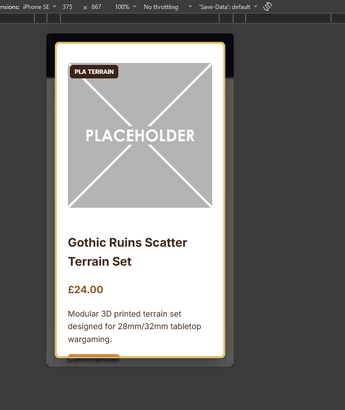 | 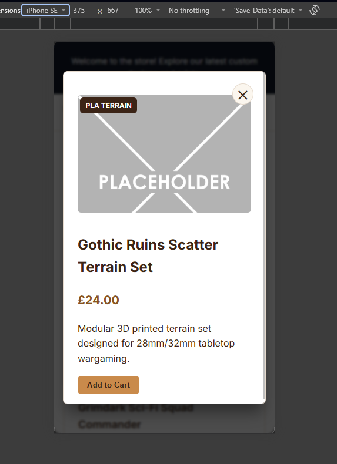 |

##### Defect Analysis & Technical Solutions:

1. **Vertical Boundary Overflow & Off-Screen CTA Clipping**
   * **Root Cause:** On short viewports (such as the iPhone SE at `667px` height), fixed image dimensions pushed the bottom of the modal content past the viewport fold. This clipped the primary "Add to Cart" button off-screen and prevented users from scrolling within the dialog.
   * **How I Fixed It:** I updated `.lightbox-dialog` in `styles.css` to enforce `max-height: 85vh` and `overflow-y: auto`. I also constrained `.lightbox-image-container` on mobile viewports to a `max-height` of `200px`, keeping the main modal content above the fold while allowing smooth internal scrolling for longer descriptions.

2. **Hidden Close Button Overlay**
   * **Root Cause:** Standard absolute positioning placed the close icon (`✕`) behind adjacent element boundaries on narrow screens.
   * **How I Fixed It:** I styled `.lightbox-close` as an elevated circular button with `position: absolute`, pinned to the top-right corner with a high `z-index: 10` and `36px × 36px` touch dimensions, ensuring quick dismissal across all devices.

---

### 4.2 Keyboard Navigation & Screen Reader Traversal (US07)

To satisfy **WCAG 2.1 SC 2.4.1 (Bypass Blocks)** and **SC 2.4.7 (Focus Visible)**, I completed a complete keyboard navigation audit across all primary interactive paths using `Tab`, `Shift+Tab`, and `Enter` keys.

* **Date:** 08/10/2026
* **User Story:** US07 - Keyboard & Screen Reader Access
* **Target Compliance:** WCAG 2.1 Level AA

#### Keyboard Traversal & Focus Audit Results

| Focus Traversal Order | Interactive Element | Trigger / Step | Expected Behavior | Result | Visual Evidence |
|---|---|---|---|---|---|
| **1 (First Focus)** | Skip Link (`#main-content`) | `Tab` from browser address bar | "Skip to main content" button slides into view at top-left with high-contrast ring (`--accent`). Pressing `Enter` shifts focus directly to `#main-content`. | **PASS** | 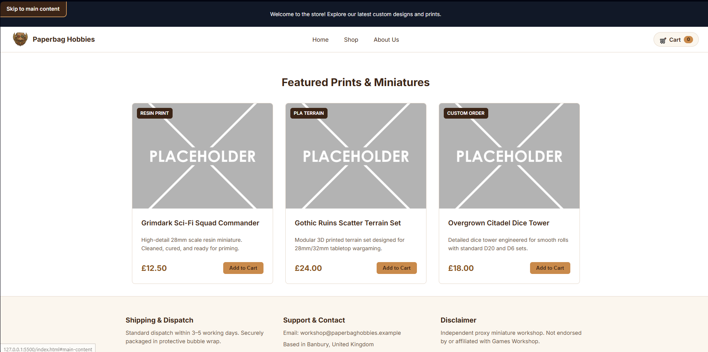 |
| **2** | Header Brand Logo | `Tab` | Outline container lights up with distinct `:focus-visible` ring. | **PASS** | Verified |
| **3** | Navigation Links (`Home`, `Shop`, `About Us`) | `Tab` / `Shift+Tab` | Traverses sequentially across links with prominent focus ring around active text. | **PASS** | Verified |
| **4** | Cart Badge Button | `Tab` | Focus ring surrounds cart button and count badge cleanly. | **PASS** | Verified |
| **5** | Product Cards & CTAs | `Tab` through catalog grid | Focus highlights image triggers, title links, and "Add to Cart" buttons in natural document order. | **PASS** | Verified |

---

## 5. Cart v2.0 Architecture, Flat-Rate Shipping & Postcode Validation

To ensure strict adherence to UK e-commerce financial standards and robust state management, I implemented and tested the Cart v2.0 architecture, featuring live postcode verification via the `postcodes.io` API, exclusive 20% UK Standard VAT, and tiered flat-rate shipping.

### 5.1 Dictionary State Management & Persistence (Bugs B3 & B8)

| Test Objective | Interaction Steps | Expected Outcome | Result | Technical Explanation / Bug Mitigation | Visual Evidence |
|---|---|---|---|---|---|
| **Quantity Updates & Zero Edge-Case (Bug B8)** | Click `+` and `-` quantity buttons in `cart.html`. | Item quantity adjusts dynamically, subtotal recalculates instantly, and global cart badge updates. When quantity drops to zero, the key is cleanly removed from dictionary state. | **PASS** | Prevents corrupted subtotal math or leftover zero-value dictionary keys in `cartState`. | Verified via DevTools inspection. |
| **Item Removal** | Click individual remove trigger (`×`) or **Clear Cart**. | Selected item (or entire cart) clears from DOM and `localStorage` state. | **PASS** | Immediate state flushing and UI re-rendering. | Verified via DevTools inspection. |
| **Cross-Tab Sync (Bug B3)** | Open store in two separate tabs, update cart in one. | `storage` event listener synchronizes cart state across tabs without manual page refresh. | **PASS** | Bound global `storage` event listener to `localStorage` mutations for real-time multi-window sync. | Verified via multi-window testing. |

---

### 5.2 Live Postcode Validation (`postcodes.io` API) (Bug B4)

| Test Objective | Interaction Steps | Expected Outcome | Result | Technical Explanation | Visual Evidence |
|---|---|---|---|---|---|
| **Valid UK Postcode** | Enter a valid UK postcode (e.g., `OX16 1AA`) into the postcode input and click **Calculate**. | API successfully queries `postcodes.io`, validates the format, and unlocks shipping calculations. | **PASS** | Asynchronous `fetch` request parses JSON response and validates postal validity. | 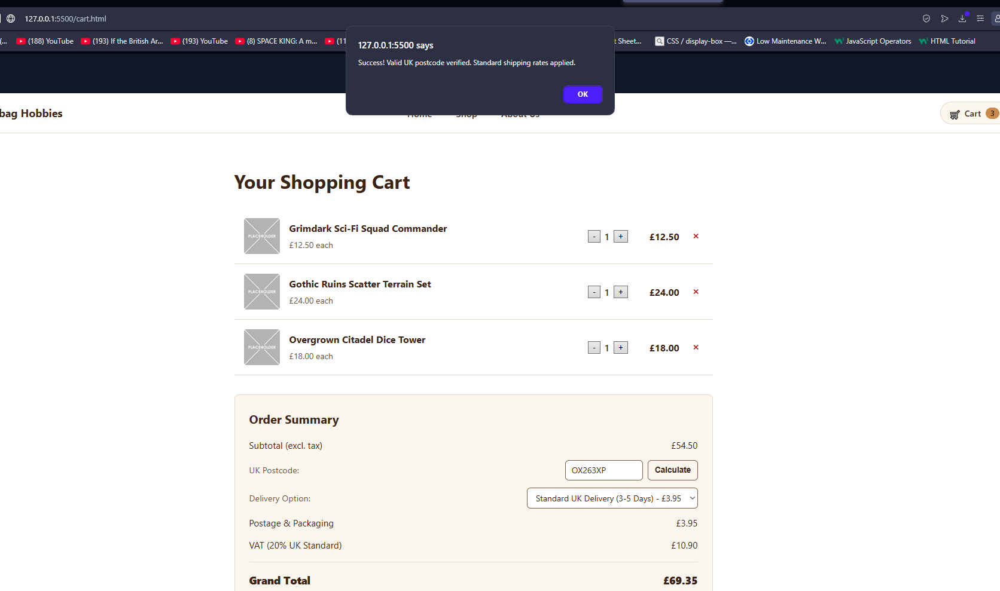 |
| **Invalid / Non-UK Postcode (Bug B4)** | Enter an invalid string or non-UK format (e.g., `12345` or `INVALID`) and click **Calculate**. | System catches API error / validation failure and presents clear error feedback to the user. | **PASS** | Defensive input validation and `try/catch` error boundaries handle failed or malformed responses gracefully. | 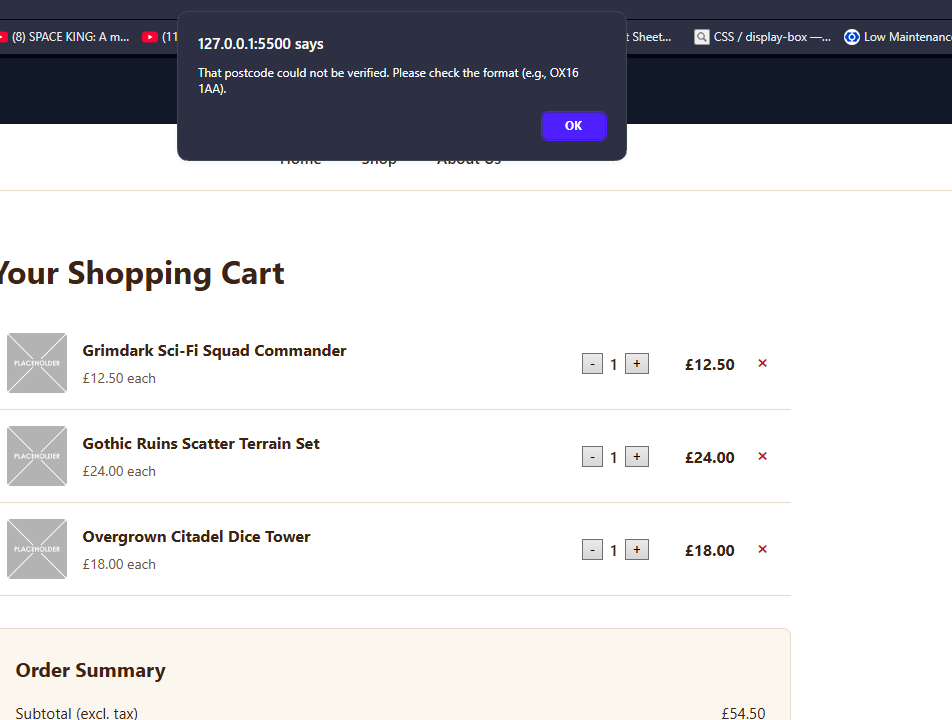 |

---

### 5.3 UK Financial Calculations (VAT & Shipping Tiers)

| Test Objective | Interaction Steps | Expected Outcome | Result | Technical Explanation | Visual Evidence |
|---|---|---|---|---|---|
| **Shipping Tier Toggle** | Switch dropdown selection between Standard UK Delivery (£3.95) and Express UK Delivery (£6.95). | Postage & Packaging line updates immediately, recalculating the final Grand Total. | **PASS** | Dynamic event listener updates delivery cost state and triggers UI recalculation. | 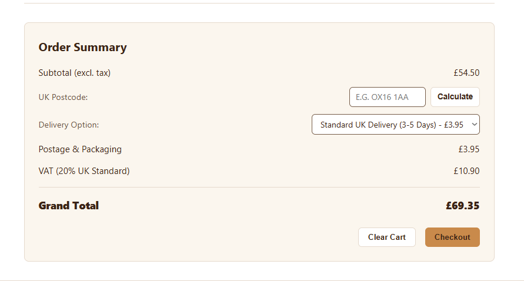 |
| **20% UK Standard VAT** | Review cart subtotal calculations with items added. | Exclusive 20% VAT is accurately computed against the taxable subtotal and summed into the Grand Total. | **PASS** | Strict mathematical separation of subtotal, tiered shipping, and 20% tax additions. |  |
| **Design System Buttons** | Inspect **Calculate** and **Clear Cart** buttons. | Buttons inherit `.btn-secondary` and `.btn-sm` token styles with correct borders, padding, and hover states. | **PASS** | Styled using established design tokens (`--bg-card`, `--border-color`, `--input-border`). | 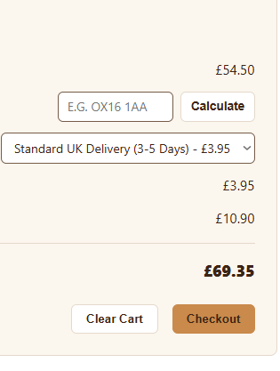 |

---

## 6. Secure Checkout Form Architecture & Guardrail Validation

To ensure robust error handling and form integrity on `checkout.html`, I implemented a comprehensive checkout validation flow backed by native HTML5 form constraints and dedicated inline guardrails.

### 6.1 HTML5 Form Grid Wrapping & Validation Architecture

| Test Objective | Interaction Steps | Expected Outcome | Result | Technical Explanation | Visual Evidence |
|---|---|---|---|---|---|
| **Form Element Scoping** | Inspect DOM structure of `checkout.html`. | The entire secure checkout grid and input fields are wrapped inside a single parent `<form>` element. | **PASS** | Ensures native HTML5 validation events, submit handling, and field focus work correctly without event-target bubbling gaps. | Verified via DevTools inspection. |
| **Empty Basket Guardrail** | Attempt to access or submit checkout with an empty `cartState`. | System catches empty state, preventing invalid order placement and displaying a clear notice. | **PASS** | Client-side logic intercepts order submissions if item counts evaluate to zero. | Verified via interaction testing. |
| **Required Shipping Inputs** | Leave mandatory shipping fields (address, postcode, contact) blank and trigger submission. | Native browser validation tooltips prompt the user, and custom inline guardrail error styling highlights missing inputs. | **PASS** | Enforced via HTML5 `required` attributes coupled with script-level error messaging guards. | Verified via interaction testing. |

### 6.2 Checkout Summary Lightbox Integration (`checkout.html`)

| Test Objective | Interaction Steps | Expected Outcome | Result | Technical Explanation | Visual Evidence |
|---|---|---|---|---|---|
| **Summary Item Inspection** | Click any miniature or terrain title/thumbnail inside the secure checkout summary card. | The native `<dialog>` product lightbox opens smoothly over the checkout view, rendering high-resolution imagery and details. | **PASS** | Injected `data-action="open-lightbox"` and `data-product-id` attributes route clicks through global event delegation without wiping form inputs or scroll position. | Verified via interaction testing. |
| **Modal Dismissal from Checkout** | Close the lightbox via `Escape` or the `✕` button while on `checkout.html`. | Lightbox closes and focus returns instantly to the clicked summary item. | **PASS** | Preserves active element focus states and form data integrity across modal cycles. | Verified via keyboard & mouse testing. |

---

## 7. Custom 404 Error Page & Deployment Verification

To satisfy comprehensive error-handling and resilient routing criteria for GitHub Pages, a custom `404.html` template was implemented, styled with the global design system, and validated against accessibility and markup standards.

### 7.1 Validation & Testing Log
| Date | Test Case | Expected Result | Actual Result | Status |
|---|---|---|---|---|
| 12/10/2026 | W3C HTML Markup Check (`404.html`) | Zero errors/warnings | Passed with 0 errors or warnings | **Pass** |
| 12/10/2026 | Heading Hierarchy Check (WCAG 2.1 AA) | Sequential order (`<h1>` $\rightarrow$ `<h2>`) | Validated sequential order without skipping levels | **Pass** |
| 12/10/2026 | Deep Route Asset Resolution on Live Site | CSS, JS, and logos load correctly on invalid nested paths (`/test-404-route`) | Absolute repository root pathing (`/Paperbaghobbies-Asessment-1/`) successfully resolved stylesheets and layout | **Pass** |
| 12/10/2026 | Responsive Layout Audit (Mobile / Desktop) | Fluid scaling and touch-friendly CTA sizing | Verified across mobile (iPhone SE) and desktop viewports | **Pass** |

### 7.2 Visual Evidence

| W3C Validation | Mobile Responsive Layout | Desktop Layout |
| :---: | :---: | :---: |
| 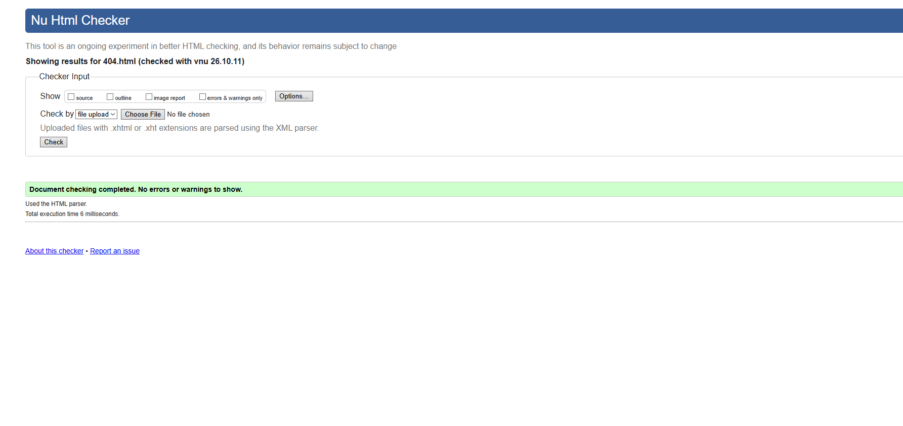 | 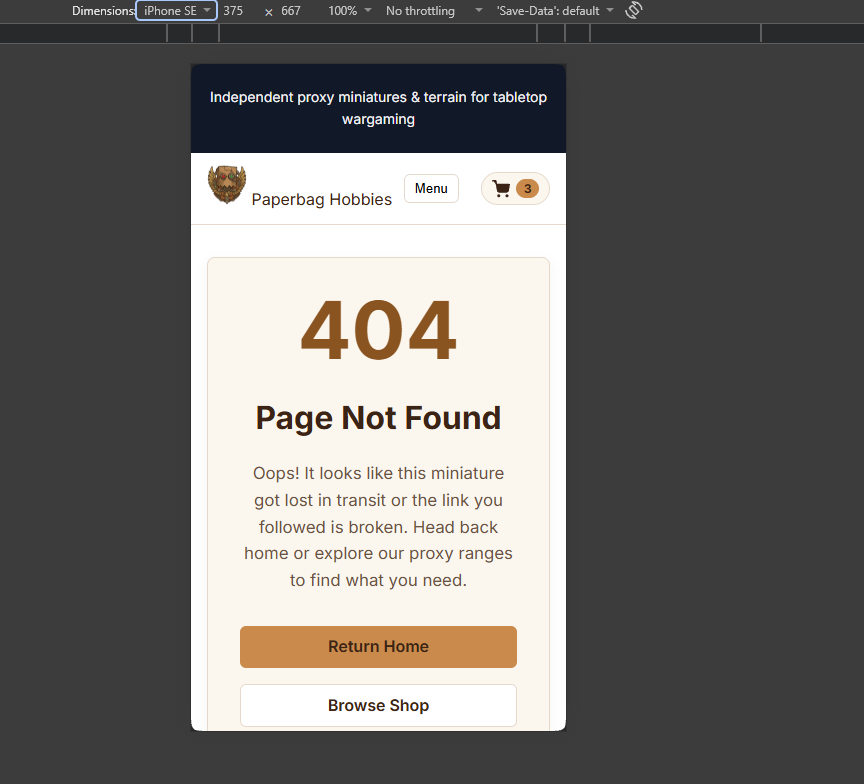 | 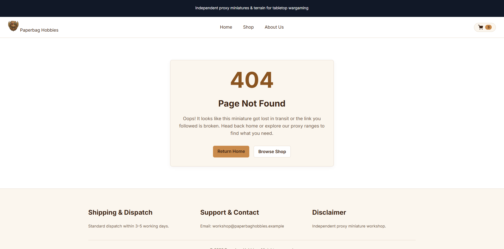 |